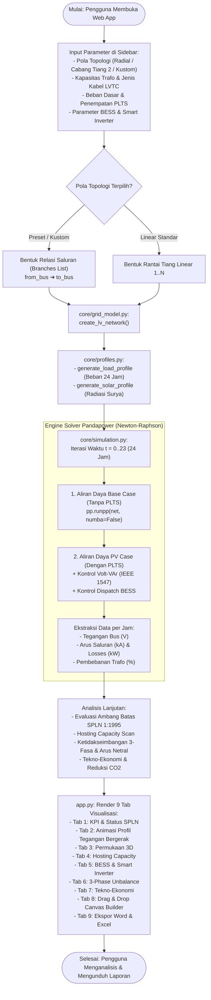

# 📘 PANDUAN KOMPREHENSIF SIDANG & ARSITEKTUR SISTEM
## VoltSolar-Sim Pro Enterprise: Platform Analisis JTR & Integrasi PLTS Atap On-Grid
**Mata Kuliah:** Praktikum Pemrograman Dasar | **Program Studi:** Teknologi Rekayasa Elektro (TRE)

---

## 🗺️ 1. Peta File & Arsitektur Direktori (*File Map*)

Struktur repositori dirancang modular mengikuti prinsip pemisahan tanggung jawab (*Separation of Concerns* / SoC), memisahkan antarmuka visual (GUI), pemodelan jaringan fisik, data profil stokastik, dan algoritma matematika sistem tenaga:

```
Projek/
│
├── core/                                   # KELOMPOK MODUL KOMPUTASI & ENGINE INTI
│   ├── __init__.py                         # Penanda package Python & ekspos API publik
│   ├── grid_model.py                      # Pemodelan fisik JTR, trafo, kabel PLN, & graf percabangan
│   ├── profiles.py                        # Generator data time-series beban 24 jam & API Cuaca BMKG
│   └── simulation.py                      # Solver Newton-Raphson, Hosting Capacity, BESS, Volt-VAr, & Ekspor
│
├── templates/
│   └── index.html                         # Frontend Web Dashboard (HTML5, CSS3 Glassmorphism, JS ES6, Plotly.js)
│
├── server.py                              # Backend Web Server & REST API Controller (Flask)
├── run_app.bat                            # Skrip peluncur otomatis 1-klik untuk Windows (Path-locked ke port 5000)
├── requirements.txt                       # Daftar pustaka eksternal (pandapower, flask, plotly, docx, dll)
├── .gitignore                             # Filter pengabaian direktori binary (.venv) dan temporary cache
└── README.md                              # Dokumentasi resmi proyek berstandar repositori GitHub
```

### Rincian Tanggung Jawab & Fungsi Kunci per File:

#### A. `templates/index.html` (Modern HTML5 Single-Page Web Frontend)
* **Tanggung Jawab:** Antarmuka pengguna (*User Interface*) berbasis HTML5, CSS3 *Glassmorphism Dark Theme*, JavaScript ES6 murni, dan visualisasi ilmiah interaktif menggunakan Plotly.js.
* **Komponen & Fitur Kunci:**
  * **Sidebar Kontrol & Form Parameter**: Pengaturan kapasitas trafo, jenis kabel pilin PLN, profil beban, kapasitas PLTS, mitigasi BESS, dan Smart Inverter.
  * **4 Preset Skenario Cepat**: Tombol 1-klik untuk menguji Skenario 1 (Normal), Skenario 2 (Beban Puncak Malam - Drop Kritis), Skenario 3 (Puncak Surya Siang - Overvoltage), dan Skenario 4 (Smart Grid Mitigasi).
  * **Live Weather Ribbon**: Menampilkan prakiraan cuaca, suhu, dan tutupan awan (*Cloud Cover*) 24 jam dari BMKG.
  * **Interactive Drag & Drop Canvas**: Memungkinkan pengguna mendesain dan menggeser posisi tiang/bus secara visual serta membentuk percabangan lateral dinamis dengan kabel SVG.
  * **Visualisasi Komprehensif**: Kartu metrik KPI, grafik animasi profil tegangan 24 jam, 3D surface plot, 2D matrix heatmap tegangan, kurva hosting capacity, analisis VUF & arus netral, serta grafik tekno-ekonomi.
  * **Bus Inspector Modal**: Modal pop-up detail untuk menginspeksi tegangan, beban, dan status SPLN saat tiang atau baris tabel diklik.
  * **Export Action Center**: Tombol unduh laporan instan dalam format Word (`.docx`) dan Excel (`.xlsx`).

#### B. `server.py` (Flask REST API Controller)
* **Tanggung Jawab:** Menyediakan endpoint REST API modular untuk melayani komunikasi frontend dengan engine komputasi di `core/`.
* **Endpoint Kunci:**
  * `GET /`: Merender halaman utama `templates/index.html`.
  * `GET /api/initial-config`: Menyediakan konfigurasi awal jaringan dan daftar kabel PLN.
  * `GET /api/bmkg`: Mengambil data cuaca dan tutupan awan aktual dari REST API BMKG.
  * `POST /api/simulate`: Menerima parameter jaringan, menjalankan simulasi 24 jam Newton-Raphson, dan mengembalikan hasil analisis lengkap dalam format JSON.
  * `POST /api/hosting-capacity`: Menghitung batas penetrasi PLTS atap maksimum secara dinamis.
  * `POST /api/export-docx` & `POST /api/export-excel`: Menghasilkan dan mengirimkan file laporan langsung ke browser pengguna.

#### B. `core/grid_model.py` (Electrical Network Topology Model)
* **Fungsi Utama:** `create_lv_network(...)`
* **Tanggung Jawab:**
  * Membangun objek `pandapowerNet` kosong (`pp.create_empty_network()`).
  * Mengonfigurasi Gardu Distribusi: Sumber Tegangan Eksternal (Sistem 20 kV / Slack Bus) dan Trafo Distribusi 20/0.4 kV (*Dyn5*) dengan impedansi hubung singkat ($v_{sc} = 4\%$).
  * Membangun bus-bus tiang tegangan rendah ($V_n = 400\text{ V}$ antar-fasa / $220\text{ V}$ fasa-netral).
  * Menghubungkan saluran menggunakan kabel pilin standar PLN (`LVTC`) dengan resistansi ($R'$) dan reaktansi ($X'$) riil per kilometer.
  * Mendukung **Percabangan Bebas (*Arbitrary Branching*)** melalui argumen `custom_branches` yang memetakan relasi `from_bus` dan `to_bus`.
  * Menghitung jarak listrik terpendek (*shortest electrical distance*) setiap tiang ke trafo menggunakan pustaka `networkx`.
  * Menempatkan beban konsumen (*asymmetric/symmetric loads*) dan pembangkit statis PLTS atap (*static generators* / `sgen`).

#### C. `core/profiles.py` (Stochastic Profiles Generator)
* **Fungsi Utama:** `generate_load_profile(...)` dan `generate_solar_profile(...)`
* **Tanggung Jawab:**
  * Mengimplementasikan kurva beban tipikal residensial Indonesia dengan koefisien waktu 24 jam (puncak malam hari pukul 19.00 - 20.00 WIB).
  * Menerapkan fluktuasi acak Gaussian (*stochastic noise*) agar setiap tiang memiliki dinamika konsumsi riil yang unik.
  * Membentuk kurva radiasi matahari harian (*clear-sky bell curve*) dengan pengaruh reduksi cuaca (*Cerah, Cerah Berawan, Berawan Tebal, Hujan*).

#### D. `core/simulation.py` (Analytical Engine & Report Generator)
* **Fungsi Utama:**
  * `run_time_series_comparison(...)`: Menjalankan iterasi aliran daya 24 jam untuk dua kondisi paralel: *Base Case* (tanpa PLTS) dan *PV Integration Case* (dengan PLTS).
  * `calculate_hosting_capacity(...)`: Algoritma pemindaian bertahap (*incremental step scan*) untuk mendeteksi kapasitas penetrasi PLTS maksimum sebelum melanggar batas SPLN ($V > 1.05\text{ p.u.}$) atau membebani trafo $> 100\%$.
  * `calculate_phase_unbalance(...)`: Menghitung ketidakseimbangan beban 3-fasa dan arus pada kawat netral:
    $$I_N = \vec{I_R} + \vec{I_S} + \vec{I_T}$$
  * `calculate_techno_economics(...)`: Menghitung penghematan biaya listrik, NPV, Payback Period, dan mitigasi $CO_2$.
  * `export_simulation_to_docx(...)`: Menghasilkan dokumen laporan formal skripsi/praktikum Microsoft Word lengkap dengan kop surat, tabel KPI, metodologi, dan kesimpulan menggunakan `python-docx`.
  * `export_simulation_to_excel(...)`: Menghasilkan laporan spreadsheet Microsoft Excel multi-sheet menggunakan `openpyxl`.

---

## 🔄 2. Alur Kerja Program (*Execution Pipeline*)

Alur kerja data dari inisialisasi hingga ekspor laporan diilustrasikan dalam diagram alir berikut:



---

## ⚡ 3. Landasan Teori Teknik Elektro & Regulasi

### A. Regulasi Tegangan SPLN 1:1995
Standar Perusahaan Listrik Negara (SPLN 1:1995) mengatur batas toleransi tegangan pelayanan pada konsumen tegangan rendah ($V_n = 220\text{ V}$ fasa-netral):
* **Batas Maksimum (+5%):** $V_{\text{max}} = 1.05 \times 220\text{ V} = \mathbf{231\text{ Volt}}$
* **Batas Minimum (-10%):** $V_{\text{min}} = 0.90 \times 220\text{ V} = \mathbf{198\text{ Volt}}$

### B. Persamaan Jatuh Tegangan ($\Delta V$) & Rasio $R/X$ Saluran TR
Pada jaringan tegangan tinggi, reaktansi saluran mendominasi ($X \gg R$). Namun pada Jaringan Tegangan Rendah (JTR), kabel pilin udara memiliki **rasio $R/X$ yang tinggi** ($R \approx 3\text{ s.d. } 5 \times X$).
Pendekatan jatuh tegangan fasa-netral pada saluran:
$$\Delta V \approx \frac{P \cdot R + Q \cdot X}{V_n}$$
* **Saat Jam Beban Puncak (Malam):** $P_{\text{load}} > 0$ dan $Q_{\text{load}} > 0 \implies \Delta V > 0 \implies$ Terjadi *undervoltage* di tiang ujung.
* **Saat Puncak Surya (Siang):** Injeksi daya aktif PLTS ($P_{\text{pv}} > 0$) membalik arah aliran daya ($P_{\text{net}} < 0$):
  $$V_{\text{bus}} \approx V_{\text{trafo}} - \frac{(-P_{\text{pv}} + P_{\text{load}}) \cdot R + Q \cdot X}{V_n}$$
  Hal ini memicu fenomena **kenaikan tegangan (*voltage rise*)**.

### C. Persamaan Rugi-Rugi Daya Teknis (*Technical Losses*)
Rugi daya aktif pada saluran kabel dengan panjang $L$ dan resistansi per km $R'$:
$$P_{\text{loss}} = I^2 \cdot R = I^2 \cdot (R' \cdot L)$$
Energi rugi-rugi total selama 24 jam:
$$E_{\text{loss}} = \sum_{t=0}^{23} P_{\text{loss}}(t) \cdot \Delta t \quad (\text{kWh})$$

### D. Smart Inverter Volt-VAr Control (IEEE 1547-2018)
Inverter modern mampu menyerap atau menginjeksi daya reaktif ($Q$) secara otonom mengikuti kurva droop berdasar tegangan terminal:
* Jika $V < 0.92\text{ p.u.}$: Injeksi $Q$ induktif maksimum ($+Q_{\text{max}}$) untuk mendongkrak tegangan.
* Jika $0.98 \le V \le 1.02\text{ p.u.}$: Zona mati (*Deadband*), $Q = 0$.
* Jika $V > 1.05\text{ p.u.}$: Absorpsi $Q$ kapasitif/underexcited ($-Q_{\text{max}}$) untuk meredam *overvoltage*.

---

## 🎯 4. Bank 25 Prediksi Pertanyaan Dosen Penguji & Kunci Jawabannya

Berikut adalah ringkasan pertanyaan yang paling sering diajukan dosen dalam sidang/ujian proyek:

### KELOMPOK 1: Pemrograman Komputer & Algoritma (Python)

**Q1: Mengapa kalian menggunakan pustaka `pandapower` dan bukan menulis solver aliran daya manual dari nol?**
> **Jawaban:**
> `pandapower` adalah standar industri terbuka berbasis Python yang dibangun di atas `scipy` dan `numpy`. Kami memanfaatkan `pandapower` karena telah teruji (*benchmark*) internasional untuk menyelesaikan persamaan aliran daya non-linear multivariat Newton-Raphson yang sangat stabil, efisien, dan mendukung model trafo riil (impedansi hubung singkat, tap changer, grup vektor *Dyn5*) serta kabel standar SPLN. Fokus proyek kami adalah pemodelan arsitektur JTR, dinamika stokastik 24 jam, logika mitigasi cerdas (BESS & Volt-VAr), dan visualisasi interaktif modern.

**Q2: Bagaimana cara kalian mengimplementasikan topologi percabangan (*branching/tree*) pada kode program?**
> **Jawaban:**
> Topologi percabangan direpresentasikan menggunakan struktur data *list of dictionaries* yang menyimpan relasi graf: `[{"from": bus_induk, "to": bus_anak}]`. Objek graf ini kemudian dipetakan ke dalam `pandapower` menggunakan `pp.create_line_from_parameters()`. Untuk menghitung jarak fisik tiang cabang ke trafo pangkal secara akurat, kami menggunakan pustaka `networkx` dengan fungsi `nx.shortest_path_length()` berbobot panjang gawang (*span length*).

**Q3: Bagaimana fitur Drag & Drop pada Canvas Topologi bekerja dan bagaimana integrasinya dengan backend Flask?**
> **Jawaban:**
> Canvas Drag & Drop diimplementasikan menggunakan HTML5 Canvas, SVG dinamis, dan JavaScript ES6 murni. Setiap tiang/bus dimodelkan sebagai elemen grafis interaktif dengan event listener `mousedown`, `mousemove`, dan `mouseup`. Garis kabel dirender dinamis menggunakan vektor SVG (`<path>` / `<line>`) yang koordinat ujungnya selalu terikat pada pusat posisi node yang digeser. Saat pengguna memodifikasi topologi atau menambah percabangan, representasi struktur data JSON dikirimkan secara asinkron (*AJAX / Fetch API*) ke backend Flask melalui endpoint `POST /api/simulate` untuk memicu komputasi ulang Newton-Raphson secara instan tanpa perlu memuat ulang (*reload*) seluruh halaman web.

**Q4: Apa fungsi file `run_app.bat` dan mengapa menggunakan parameter `%~dp0`?**
> **Jawaban:**
> `run_app.bat` adalah skrip otomatis sekali klik (*one-click runner*) untuk pengguna Windows. Parameter `%~dp0` berfungsi mengunci direktori kerja (*working directory*) ke folder di mana file batch tersebut berada. Hal ini mencegah kegagalan path saat file batch dijalankan dari shortcut atau File Explorer, serta secara otomatis meluncurkan browser menuju `http://localhost:5000`.

**Q5: Mengapa folder `.venv` dilarang di-upload ke repositori GitHub?**
> **Jawaban:**
> Karena `.venv` berisi ribuan file biner Python hasil kompilasi lokal yang ukurannya mencapai ratusan megabyte dan spesifik untuk arsitektur OS pembuatnya. Praktik terbaik dalam rekayasa perangkat lunak adalah menyertakan file `requirements.txt` dan mengonfigurasi `.gitignore` sehingga penguji atau kolaborator dapat merekonstruksi *environment* yang sama persis menggunakan perintah `pip install -r requirements.txt`.

---

### KELOMPOK 2: Sistem Tenaga Listrik & Regulasi SPLN

**Q6: Mengapa pada siang hari saat PLTS berproduksi maksimal, tegangan jaringan justru naik (*voltage rise*)?**
> **Jawaban:**
> Sesuai persamaan aproksimasi jatuh tegangan $\Delta V \approx (P \cdot R + Q \cdot X)/V_n$, jaringan tegangan rendah (JTR) memiliki nilai resistansi ($R$) kabel yang signifikan. Ketika PLTS menginjeksi daya aktif ($P_{\text{pv}}$) melebihi daya yang dikonsumsi beban lokal ($P_{\text{load}}$), arah aliran daya aktif berbalik ke arah trafo ($P_{\text{net}} < 0$). Nilai $P_{\text{net}}$ yang negatif ini menyebabkan $\Delta V$ bernilai negatif, yang berarti tegangan di bus tiang menjadi lebih tinggi daripada tegangan di gardu trafo pangkal (*voltage rise*).

**Q7: Berapa batas toleransi tegangan standar PLN menurut SPLN 1:1995 yang kalian gunakan dalam evaluasi?**
> **Jawaban:**
> Mengacu pada SPLN 1:1995, variasi tegangan pelayanan fasa-netral nominal $220\text{ V}$ ditetapkan pada rentang toleransi:
> * Batas Atas ($+5\%$): $1.05\text{ p.u.} = 231.0\text{ Volt}$
> * Batas Bawah ($-10\%$): $0.90\text{ p.u.} = 198.0\text{ Volt}$
> Sistem kami mengevaluasi setiap tiang pada setiap jam selama 24 jam. Jika tegangan $< 198\text{ V}$ atau $> 231\text{ V}$, status kepatuhan SPLN otomatis dinyatakan *Non-Compliant* (Pelanggaran).

**Q8: Mengapa pemasangan PLTS di ujung saluran (*feeder end*) memberikan dampak kenaikan tegangan paling drastis dibandingkan di dekat trafo?**
> **Jawaban:**
> Karena impedansi kumulatif ($R_{\text{total}} = \sum R_i$) dari tiang ujung ke gardu trafo adalah yang paling besar. Ketika daya surya diinjeksikan pada titik dengan impedansi saluran tertinggi, drop tegangan balik $\Delta V = I_{\text{pv}} \cdot R_{\text{total}}$ akan menghasilkan lonjakan tegangan terminal paling signifikan.

**Q9: Apa yang dimaksud dengan *Reverse Power Flow* dan apa dampaknya bagi sistem distribusi?**
> **Jawaban:**
> *Reverse Power Flow* adalah kondisi ketika daya aktif total dari pembangkit tersebar (PLTS) melebihi total konsumsi beban di bawah satu gardu, sehingga daya mengalir berbalik dari jaringan tegangan rendah (sekunder trafo) menuju jaringan tegangan menengah 20 kV (primer trafo). Dampaknya dapat mengacaukan koordinasi proteksi rele arus lebih (*overcurrent relay*), menyebabkan disgulir tap changer mekanis, serta menaikkan tegangan pada belitan sekunder trafo.

---

### KELOMPOK 3: Fitur Cerdas (Smart Grid) & Inovasi

**Q10: Apa itu *Hosting Capacity* dan bagaimana algoritma kalian menghitungnya?**
> **Jawaban:**
> *Hosting Capacity* adalah batas kapasitas maksimum daya pembangkit tersebar (kWp PLTS) yang dapat diintegrasikan ke dalam suatu penyulang tanpa melanggar batasan operasional jaringan. Algoritma kami bekerja dengan metode pemindaian inkremental (*step-scan iteration*): kapasitas PLTS dinaikkan bertahap dari 1 kWp hingga 15 kWp per rumah. Pada setiap tahap, aliran daya dijalankan. Hosting capacity tercapai tepat sebelum tegangan bus melampaui $1.05\text{ p.u.}$ ($231\text{ V}$) atau pembebanan trafo melebihi $100\%$.

**Q11: Bagaimana prinsip kerja Smart Inverter Volt-VAr (IEEE 1547-2018) dalam menstabilkan tegangan?**
> **Jawaban:**
> Smart Inverter memanfaatkan sisa kapasitas inverter ($S^2 = P^2 + Q^2$) untuk mengontrol daya reaktif ($Q$). Saat tegangan naik melebihi batas normal ($V > 1.02\text{ p.u.}$), inverter beroperasi pada kondisi *underexcited* dan menyerap daya reaktif induktif ($-Q$) dari grid, sehingga suku $Q \cdot X$ pada rumus jatuh tegangan bernilai negatif dan meredam lonjakan tegangan kembali ke batas aman SPLN.

**Q12: Apa peran BESS (Battery Energy Storage System) dalam simulasi kalian?**
> **Jawaban:**
> BESS memiliki fungsi ganda:
> 1. *Solar Curtailment Avoidance & Voltage Support* pada siang hari (11.00 - 14.00): Mengisi daya (*charging*) menggunakan kelebihan energi surya sehingga memangkas lonjakan daya balik (*peak shaving*) dan mencegah *overvoltage*.
> 2. *Peak Shaving* pada malam hari (18.00 - 21.00): Mengosongkan daya (*discharging*) untuk melayani beban rumah tangga saat jam beban puncak, sehingga mengurangi arus saluran dari trafo dan mencegah tegangan drop (*undervoltage*).

**Q13: Bagaimana kalian menghitung ketidakseimbangan beban 3-fasa dan arus kawat netral ($I_N$)?**
> **Jawaban:**
> Pelanggan rumah tangga satu fasa didistribusikan ke tiga fasa (R, S, T). Pada kondisi asimetris, jumlah fasor arus ketiga fasa tidak sama dengan nol. Sesuai Hukum Kirchhoff Arus (KCL), arus yang kembali melalui kawat netral dihitung dengan penjumlahan fasor:
> $$\vec{I_N} = \vec{I_R} + \vec{I_S} + \vec{I_T} = I_R \angle 0^\circ + I_S \angle -120^\circ + I_T \angle +120^\circ$$
> Sistem kami menghitung besarnya $I_N$ dan memvalidasi potensi rugi daya teknis tambahan pada kawat netral.

---

### KELOMPOK 4: Pertanyaan Kritis / Pengujian Ekstrem

**Q14: Jika beban rumah tangga dinaikkan 5 kali lipat secara serentak, apa yang terjadi pada sistem?**
> **Jawaban:**
> Terjadi dua pelanggaran fatal:
> 1. Jatuh tegangan drastis di tiang ujung hingga jauh di bawah $0.90\text{ p.u.}$ ($< 198\text{ V}$), memicu pelanggaran SPLN berat (*severe undervoltage*).
> 2. Trafo distribusi dan kabel fasa awal akan mengalami pembebanan lebih (*overload* $> 100\%$) yang memicu proteksi sekring pelebur (fuse cutout) putus.

**Q15: Apa keunggulan ekspor laporan otomatis Word (`.docx`) dibandingkan jika kalian menyalin grafik satu per satu secara manual?**
> **Jawaban:**
> Ekspor laporan otomatis via `python-docx` pada Tab 9 menjamin integritas data 100% konsisten antara hasil komputasi dan narasi laporan, mengeliminasi kesalahan manusia (*human error*), serta menghasilkan dokumen tugas akhir formal lengkap dengan identitas kelompok, tabel KPI, metodologi, dan kesimpulan hanya dalam satu klik.
