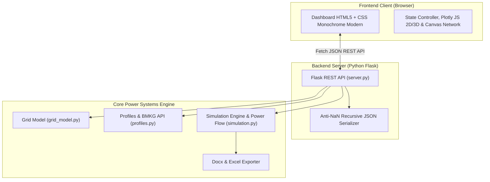

# PETA LENGKAP FITUR & LOKASI KODE (VOLTSOLAR-SIM PRO ENTERPRISE)
**Projek Praktikum Pemrograman Dasar & Teknologi Rekayasa Elektro**  
**Aplikasi: Simulator Jaringan Distribusi JTR & PLTS Atap On-Grid Berbasis Web Dashboard Interaktif & Python REST API**

---

## 📑 DAFTAR ISI
1. [Ringkasan Arsitektur Sistem](#1-ringkasan-arsitektur-sistem)
2. [Peta Seluruh Fitur Frontend (10 Tab & Menu Navigasi)](#2-peta-seluruh-fitur-frontend-10-tab--menu-navigasi)
3. [Peta Seluruh Endpoint Backend (Flask REST API)](#3-peta-seluruh-endpoint-backend-flask-rest-api)
4. [Peta Engine Komputasi Sistem Tenaga Listrik](#4-peta-engine-komputasi-sistem-tenaga-listrik)
5. [Peta File & Skrip Otomasi Deployment](#5-peta-file--skrip-otomasi-deployment)
6. [Tabel Matriks Fitur vs File & Baris Kode](#6-tabel-matriks-fitur-vs-file--baris-kode)

---

## 1. RINGKASAN ARSITEKTUR SISTEM

Sistem VoltSolar-Sim Pro dibangun menggunakan arsitektur **Client-Server Modern**:

* **Frontend**: Single-Page Application (SPA) responsif tanpa ketergantungan library berat, menggunakan Vanilla JavaScript, Chart.js / Plotly.js untuk visualisasi grafik teknis, dan HTML5 Canvas untuk diagram topologi satu garis (*Single Line Diagram*).
* **Backend (`server.py`)**: Web service Flask ringan yang menangani routing HTTP, validasi input parameter, pembersihan data (*Anti-NaN serialization*), dan *streaming* file biner DOCX/XLSX.
* **Core Engine (`core/`)**: Mesin komputasi aliran daya industri berbasis library `pandapower`, pemodelan kurva beban & radiasi BMKG, serta analisis tekno-ekonomi sesuai standar SPLN dan regulasi energi terbarukan Indonesia.

---

## 2. PETA SELURUH FITUR FRONTEND (10 TAB & MENU NAVIGASI)
File utama frontend berada di: [Web/index.html](file:///c:/Nala%20Alma%20Syafif/Kuliah/Praktikum%20Pemrograman%20Dasar/Projek/Web/index.html)

### A. Komponen Navigasi, Header & Sidebar
1. **Header & Status Live**:
   * Menampilkan logo, nama aplikasi, status koneksi server, dan jam digital real-time.
   * Lokasi kode: [Web/index.html#L110-L160](file:///c:/Nala%20Alma%20Syafif/Kuliah/Praktikum%20Pemrograman%20Dasar/Projek/Web/index.html#L110-L160)
2. **Sidebar Panel Kontrol Parameter**:
   * Pilihan topologi (Linear Radial vs Kustom Bercabang).
   * Konfigurasi tiang (jumlah tiang, jarak gawang span length, jenis kabel LVTC PLN, kapasitas trafo Dyn5).
   * Konfigurasi beban dasar (kW/tiang, cos phi, variasi stokastik).
   * Konfigurasi PLTS Atap (penempatan, kapasitas kWp per rumah).
   * Konfigurasi cuaca (Koneksi BMKG 38 kota vs Preset Cuaca).
   * Preset Tarif Daya PLN (450 VA, 900 VA Subsidi, 900 VA RTM, 1300 VA, 2200 VA, dst.).
   * Lokasi kode: [Web/index.html#L1250-L1490](file:///c:/Nala%20Alma%20Syafif/Kuliah/Praktikum%20Pemrograman%20Dasar/Projek/Web/index.html#L1250-L1490)

---

### B. Detail Fitur di 10 Tab Interaktif
#### 1. Tab 0: 💡 Info Penting Konsumen (Top 5 Menu Rekomendasi)
* **Tujuan**: Menyajikan ringkasan ramah non-teknis bagi pemilik rumah / konsumen PLTS.
* **Isi Fitur**:
  * 5 Menu Unggulan: Estimasi Penghematan Tagihan Bulanan, Kepatuhan Tegangan Rumah, Kapasitas Maksimal Terpasang, Waktu Balik Modal (Payback Period), dan Status Rekomendasi Baterai (BESS).
  * Kartu Edukasi Manfaat Lingkungan (Ton CO2 berkurang & setara penanaman pohon).
* **Lokasi HTML**: [Web/index.html#L1530-L1815](file:///c:/Nala%20Alma%20Syafif/Kuliah/Praktikum%20Pemrograman%20Dasar/Projek/Web/index.html#L1530-L1815)
* **Lokasi JS Render**: [Web/index.html#L2680-L2745](file:///c:/Nala%20Alma%20Syafif/Kuliah/Praktikum%20Pemrograman%20Dasar/Projek/Web/index.html#L2680-L2745)

#### 2. Tab 1: 📊 Ringkasan & Standar SPLN 1:1995
* **Tujuan**: Audit kepatuhan teknis tegangan terhadap regulasi SPLN PLN (-10% s/d +5% nominal).
* **Isi Fitur**:
  * 4 KPI Cards: Drop Tegangan Maksimum, Kenaikan Tegangan PV, Total Rugi Daya (Losses), Status Kepatuhan SPLN (Lolos / Waspada).
  * Grafik Profil Tegangan Sepanjang Feeder (Base Case vs PV Case).
  * Grafik Kurva Beban Agregat vs Kurva Injeksi PLTS 24 Jam.
* **Lokasi HTML**: [Web/index.html#L1820-L1920](file:///c:/Nala%20Alma%20Syafif/Kuliah/Praktikum%20Pemrograman%20Dasar/Projek/Web/index.html#L1820-L1920)
* **Lokasi JS Render**: [Web/index.html#L2750-L2830](file:///c:/Nala%20Alma%20Syafif/Kuliah/Praktikum%20Pemrograman%20Dasar/Projek/Web/index.html#L2750-L2830)

#### 3. Tab 2: 🎬 Animasi Playback 24 Jam
* **Tujuan**: Menampilkan dinamika fluktuasi tegangan dan pembebanan trafo sepanjang hari secara visual dinamis.
* **Isi Fitur**:
  * Slider waktu 00:00 - 23:00 WIB dengan tombol Play/Pause otomatis.
  * Grafik profil tegangan dinamis tiap tiang yang berubah setiap detik.
  * Bar pembebanan trafo distribusi (%) terhadap kapasitas pengenal kVA.
* **Lokasi HTML**: [Web/index.html#L1925-L1970](file:///c:/Nala%20Alma%20Syafif/Kuliah/Praktikum%20Pemrograman%20Dasar/Projek/Web/index.html#L1925-L1970)
* **Lokasi JS Playback Loop**: [Web/index.html#L2835-L2890](file:///c:/Nala%20Alma%20Syafif/Kuliah/Praktikum%20Pemrograman%20Dasar/Projek/Web/index.html#L2835-L2890)

#### 4. Tab 3: 🌐 Permukaan 3D (Spatiotemporal Voltage Surface)
* **Tujuan**: Visualisasi multi-dimensi tegangan terhadap Jam (Sumbu X) dan Jarak Tiang (Sumbu Y).
* **Isi Fitur**:
  * Grafik 3D Plotly interaktif yang dapat diputar (*rotate*), digeser (*pan*), dan di-zoom.
  * 4 Tombol Skenario:
    1. **⚡ Dengan PLTS**: Menampilkan fenomena *voltage rise* di siang hari.
    2. **🔌 Tanpa PLTS**: Menampilkan fenomena *voltage drop* di malam hari.
    3. **⚖️ Bandingan Keduanya (3D)**: Overlay bidang transparan komparasi langsung.
    4. **📈 Kenaikan Tegangan (Delta-V)**: Kontur selisih kenaikan tegangan bersih akibat PLTS.
* **Lokasi HTML**: [Web/index.html#L1975-L2020](file:///c:/Nala%20Alma%20Syafif/Kuliah/Praktikum%20Pemrograman%20Dasar/Projek/Web/index.html#L1975-L2020)
* **Lokasi JS Plotly 3D**: [Web/index.html#L2895-L2985](file:///c:/Nala%20Alma%20Syafif/Kuliah/Praktikum%20Pemrograman%20Dasar/Projek/Web/index.html#L2895-L2985)

#### 5. Tab 4: ⚡ Hosting Capacity (Kapasitas Tampung Maksimum JTR)
* **Tujuan**: Mengetahui berapa kWp PLTS maksimum yang boleh disambungkan sebelum jaringan mengalami trip/overvoltage.
* **Isi Fitur**:
  * Pemindaian otomatis bertahap dari 0 kWp hingga 8+ kWp saat radiasi puncak jam 12:00.
  * Deteksi faktor pembatas (*limiting factor*): Overvoltage kabel, Overload trafo, atau Rugi daya.
  * Grafik kurva batas penetrasi PLTS aman.
* **Lokasi HTML**: [Web/index.html#L2025-L2075](file:///c:/Nala%20Alma%20Syafif/Kuliah/Praktikum%20Pemrograman%20Dasar/Projek/Web/index.html#L2025-L2075)
* **Lokasi JS Scan Trigger**: [Web/index.html#L2990-L3055](file:///c:/Nala%20Alma%20Syafif/Kuliah/Praktikum%20Pemrograman%20Dasar/Projek/Web/index.html#L2990-L3055)

#### 6. Tab 5: 🔋 BESS (Baterai) & Smart Inverter Volt-VAr
* **Tujuan**: Solusi mitigasi kestabilan jaringan tingkat lanjut (*grid support*).
* **Isi Fitur**:
  * Simulasi Baterai LiFePO4: Charging saat surya berlebih siang hari, Discharging saat beban puncak malam.
  * Grafik State of Charge (SoC %) baterai 24 jam.
  * Kontrol Daya Reaktif Smart Inverter Volt-VAr sesuai standar **IEEE 1547-2018**.
* **Lokasi HTML**: [Web/index.html#L2080-L2130](file:///c:/Nala%20Alma%20Syafif/Kuliah/Praktikum%20Pemrograman%20Dasar/Projek/Web/index.html#L2080-L2130)
* **Lokasi JS BESS Logic**: [Web/index.html#L3060-L3110](file:///c:/Nala%20Alma%20Syafif/Kuliah/Praktikum%20Pemrograman%20Dasar/Projek/Web/index.html#L3060-L3110)

#### 7. Tab 6: ⚖️ Ketidakseimbangan 3-Fasa & Arus Kawat Netral
* **Tujuan**: Analisis ketidakseimbangan beban antar fasa R, S, dan T pada jaringan distribusi 4-kawat.
* **Isi Fitur**:
  * Alokasi fasa tiang (Seimbang bergantian R-S-T, Berat di fasa R, atau Terkonsentrasi fasa T).
  * Perhitungan *Voltage Unbalance Factor* (VUF %) standar **IEC 61000-4-30** dan **IEEE 1129**.
  * Perhitungan aliran arus pada kawat netral (In) akibat penjumlahan vektor phasor 3-fasa.
  * Perhitungan rugi daya tembaga kawat netral (In^2 * Rn).
* **Lokasi HTML**: [Web/index.html#L2135-L2180](file:///c:/Nala%20Alma%20Syafif/Kuliah/Praktikum%20Pemrograman%20Dasar/Projek/Web/index.html#L2135-L2180)
* **Lokasi JS 3-Phase**: [Web/index.html#L3115-L3170](file:///c:/Nala%20Alma%20Syafif/Kuliah/Praktikum%20Pemrograman%20Dasar/Projek/Web/index.html#L3115-L3170)

#### 8. Tab 7: 💰 Tekno-Ekonomi & Emisi Karbon
* **Tujuan**: Analisis kelayakan finansial investasi PLTS Atap dan dampak reduksi emisi gas rumah kaca.
* **Isi Fitur**:
  * Pilihan Tarif PLN Otomatis: 450 VA (Rp 415), 900 VA Subsidi (Rp 605), 900 VA RTM (Rp 1.352), 1300-6600 VA (Rp 1.444,70).
  * Perhitungan CAPEX (Biaya Investasi Awal).
  * Perhitungan OPEX, Penghematan Tahunan, dan Periode Pengembalian Modal (*Simple Payback Period*).
  * Analisis *Net Present Value* (NPV) proyek selama 25 tahun dengan faktor diskonto (*discount rate*).
  * Perhitungan reduksi emisi CO2 (ton/tahun) berdasarkan faktor emisi grid Jawa-Madura-Bali (Jamali).
* **Lokasi HTML**: [Web/index.html#L2185-L2240](file:///c:/Nala%20Alma%20Syafif/Kuliah/Praktikum%20Pemrograman%20Dasar/Projek/Web/index.html#L2185-L2240)
* **Lokasi JS Financial**: [Web/index.html#L3175-L3250](file:///c:/Nala%20Alma%20Syafif/Kuliah/Praktikum%20Pemrograman%20Dasar/Projek/Web/index.html#L3175-L3250)

#### 9. Tab 8: 🗺️ Visualisasi Topologi & Interactive Drag-Drop
* **Tujuan**: Menggambar skematik diagram satu garis (*Single Line Diagram*) jaringan JTR secara grafis interaktif.
* **Isi Fitur**:
  * Visualisasi posisi Gardu Trafo Distribusi, kabel pilin LVTC, tiang listrik, dan rumah ber-PLTS.
  * Fitur interaktif: Geser (*drag*) tiang listrik di atas layar Canvas HTML5.
  * Dukungan topologi radial murni maupun topologi bercabang (*tree branch*).
* **Lokasi HTML**: [Web/index.html#L2245-L2310](file:///c:/Nala%20Alma%20Syafif/Kuliah/Praktikum%20Pemrograman%20Dasar/Projek/Web/index.html#L2245-L2310)
* **Lokasi JS Canvas Engine**: [Web/index.html#L3255-L3380](file:///c:/Nala%20Alma%20Syafif/Kuliah/Praktikum%20Pemrograman%20Dasar/Projek/Web/index.html#L3255-L3380)

#### 10. Tab 9: 📑 Ekspor Laporan Resmi (Word & Excel)
* **Tujuan**: Mengunduh berkas laporan rekayasa profesional siap cetak.
* **Isi Fitur**:
  * Formulir data properti konsumen (Nama Pemilik, Alamat, ID Pelanggan PLN, Nama Konsultan, Opsi Baterai).
  * Tombol **"📄 Unduh Laporan Audit Teknis (.docx)"**: Dokumen Word rapi dengan kop profesional, tabel metrik, analisis SPLN, dan tanda tangan legalitas.
  * Tombol **"📊 Unduh Lembar Kerja Analisis (.xlsx)"**: Spreadsheet Excel lengkap dengan 6 sheet (Ringkasan, 24h Time-Series, Matriks Tegangan Base, Matriks Tegangan PV, 3-Fasa Unbalance, dan Tekno-Ekonomi).
* **Lokasi HTML**: [Web/index.html#L2315-L2370](file:///c:/Nala%20Alma%20Syafif/Kuliah/Praktikum%20Pemrograman%20Dasar/Projek/Web/index.html#L2315-L2370)
* **Lokasi JS Export Triggers**: [Web/index.html#L3385-L3460](file:///c:/Nala%20Alma%20Syafif/Kuliah/Praktikum%20Pemrograman%20Dasar/Projek/Web/index.html#L3385-L3460)

---

## 3. PETA SELURUH ENDPOINT BACKEND (FLASK REST API)
File backend utama berada di: [server.py](file:///c:/Nala%20Alma%20Syafif/Kuliah/Praktikum%20Pemrograman%20Dasar/Projek/server.py)

| No | Endpoint HTTP | Method | Fungsi & Peran | Lokasi Baris Kode |
| :---: | :--- | :---: | :--- | :--- |
| **1** | `/` | `GET` | Merender antarmuka dashboard HTML5 utama (`render_template("index.html")`). | [server.py#L73-L77](file:///c:/Nala%20Alma%20Syafif/Kuliah/Praktikum%20Pemrograman%20Dasar/Projek/server.py#L73-L77) |
| **2** | `/api/initial-config` | `GET` | Mengirimkan daftar katalog kabel LVTC, tipe trafo PLN, daftar kota BMKG, dan topologi default ke UI saat pertama kali dimuat. | [server.py#L80-L103](file:///c:/Nala%20Alma%20Syafif/Kuliah/Praktikum%20Pemrograman%20Dasar/Projek/server.py#L80-L103) |
| **3** | `/api/bmkg` | `GET` | Memanggil REST API resmi BMKG untuk mengambil data suhu, kelembaban, dan estimasi tutupan awan kota tertentu secara real-time. | [server.py#L106-L112](file:///c:/Nala%20Alma%20Syafif/Kuliah/Praktikum%20Pemrograman%20Dasar/Projek/server.py#L106-L112) |
| **4** | `/api/simulate` | `POST` | Endpoint simulasi utama: menjalankan aliran daya Newton-Raphson 24 jam komparasi Base Case vs PV Case, BESS, Smart Inverter, 3-Fasa, dan Finansial. | [server.py#L115-L318](file:///c:/Nala%20Alma%20Syafif/Kuliah/Praktikum%20Pemrograman%20Dasar/Projek/server.py#L115-L318) |
| **5** | `/api/hosting-capacity` | `POST` | Menjalankan iterasi penetrasi PLTS (0 kWp s/d 8+ kWp) pada jam 12:00 untuk memetakan batas daya maksimum feeder JTR. | [server.py#L320-L377](file:///c:/Nala%20Alma%20Syafif/Kuliah/Praktikum%20Pemrograman%20Dasar/Projek/server.py#L320-L377) |
| **6** | `/api/export-docx` | `POST` | Menghasilkan dan men-stream berkas laporan audit profesional Microsoft Word (`.docx`) dalam format biner `BytesIO`. | [server.py#L380-L441](file:///c:/Nala%20Alma%20Syafif/Kuliah/Praktikum%20Pemrograman%20Dasar/Projek/server.py#L380-L441) |
| **7** | `/api/export-excel` | `POST` | Menghasilkan dan men-stream buku kerja spreadsheet audit lengkap Microsoft Excel (`.xlsx`) berisi 6 lembar kerja teknis. | [server.py#L444-L500](file:///c:/Nala%20Alma%20Syafif/Kuliah/Praktikum%20Pemrograman%20Dasar/Projek/server.py#L444-L500) |
| **8** | `sanitize_json()` | *Helper* | Serializer rekursif anti-NaN dan anti-Infinity yang menjamin respons JSON selalu valid 100% dan tidak pernah menyebabkan crash di browser. | [server.py#L38-L70](file:///c:/Nala%20Alma%20Syafif/Kuliah/Praktikum%20Pemrograman%20Dasar/Projek/server.py#L38-L70) |

---

## 4. PETA ENGINE KOMPUTASI SISTEM TENAGA LISTRIK

### A. Modul Pemodelan JTR: [core/grid_model.py](file:///c:/Nala%20Alma%20Syafif/Kuliah/Praktikum%20Pemrograman%20Dasar/Projek/core/grid_model.py)
* **Katalog Kabel LVTC PLN (`CABLE_TYPES`)**:
  * Spesifikasi $R$ ($\Omega$/km), $X$ ($\Omega$/km), Kuat Hantar Arus (KHA maks kA) untuk ukuran kabel 70 mm², 50 mm², 35 mm², dan 25 mm².
  * Lokasi: [core/grid_model.py#L27-L51](file:///c:/Nala%20Alma%20Syafif/Kuliah/Praktikum%20Pemrograman%20Dasar/Projek/core/grid_model.py#L27-L51)
* **Katalog Trafo Distribusi (`TRANSFORMER_TYPES`)**:
  * Kapasitas 50 kVA, 100 kVA, 160 kVA, 200 kVA, 250 kVA (Rasio 20 kV / 0.4 kV, Vektor Dyn5, Rugi Tembaga, Rugi Inti, Tegangan Impedansi).
  * Lokasi: [core/grid_model.py#L54-L88](file:///c:/Nala%20Alma%20Syafif/Kuliah/Praktikum%20Pemrograman%20Dasar/Projek/core/grid_model.py#L54-L88)
* **Pembangun Jaringan Distribusi (`create_lv_network`)**:
  * Membangun model matematis busbar, trafo step-down, saluran kabel pilin, titik beban rumah tangga (Load PQ), dan static generator (PLTS sgen) pada struktur data pandapower.
  * Lokasi: [core/grid_model.py#L92-L286](file:///c:/Nala%20Alma%20Syafif/Kuliah/Praktikum%20Pemrograman%20Dasar/Projek/core/grid_model.py#L92-L286)

---

### B. Modul Profil Beban & Cuaca BMKG: [core/profiles.py](file:///c:/Nala%20Alma%20Syafif/Kuliah/Praktikum%20Pemrograman%20Dasar/Projek/core/profiles.py)
* **Kurva Beban Residensial Indonesia (`DEFAULT_LOAD_CURVE_24H`)**:
  * 24 koefisien konsumsi listrik rumah tangga dengan beban puncak malam pukul 19:00 WIB (1.0 p.u.).
  * Lokasi: [core/profiles.py#L22-L28](file:///c:/Nala%20Alma%20Syafif/Kuliah/Praktikum%20Pemrograman%20Dasar/Projek/core/profiles.py#L22-L28)
* **Model Radiasi Surya Lonceng Bell-Curve & Derating Suhu (`generate_solar_profile`)**:
  * Memodelkan radiasi matahari dari jam 06:00 sampai 18:00 WIB, atenuasi awan, dan koefisien degradasi suhu panel (-0.4%/°C di atas 25°C STC).
  * Lokasi: [core/profiles.py#L143-L195](file:///c:/Nala%20Alma%20Syafif/Kuliah/Praktikum%20Pemrograman%20Dasar/Projek/core/profiles.py#L143-L195)
* **Integrasi REST API Cuaca BMKG (`fetch_bmkg_weather`)**:
  * Mengambil data cuaca suhu, kelembaban, dan kondisi awan dari `api.bmkg.go.id` untuk 38 kota di seluruh Indonesia.
  * Lokasi: [core/profiles.py#L198-L248](file:///c:/Nala%20Alma%20Syafif/Kuliah/Praktikum%20Pemrograman%20Dasar/Projek/core/profiles.py#L198-L248)

---

### C. Modul Engine Simulasi & Analisis: [core/simulation.py](file:///c:/Nala%20Alma%20Syafif/Kuliah/Praktikum%20Pemrograman%20Dasar/Projek/core/simulation.py)
* **Solver Aliran Daya Newton-Raphson (`run_power_flow`)**:
  * Menjalankan iterasi Newton-Raphson berbasis matriks Jacobian dengan fallback otomatis ke Backward/Forward Sweep (BFSW) jika terjadi divergensi.
  * Lokasi: [core/simulation.py#L19-L34](file:///c:/Nala%20Alma%20Syafif/Kuliah/Praktikum%20Pemrograman%20Dasar/Projek/core/simulation.py#L19-L34)
* **Simulasi 24 Jam Komparasi (`run_time_series_comparison`)**:
  * Membandingkan kondisi *Base Case* (JTR murni tanpa PLTS) vs *PV Case* (dengan PLTS).
  * Menghitung rugi daya saluran kawat dan trafo ($I^2 \cdot R$), deteksi aliran daya balik (*reverse power flow*), logika State of Charge (SoC) baterai BESS, kurva IEEE 1547 Volt-VAr inverter cerdas, dan evaluasi kepatuhan batas tegangan SPLN 1:1995 (0.90 p.u. s/d 1.05 p.u.).
  * Lokasi: [core/simulation.py#L36-L295](file:///c:/Nala%20Alma%20Syafif/Kuliah/Praktikum%20Pemrograman%20Dasar/Projek/core/simulation.py#L36-L295)
* **Kapasitas Tampung PLTS Feeder (`calculate_hosting_capacity`)**:
  * Menguji kapasitas PLTS bertahap saat jam 12:00 siang hingga mencapai batas kritis tegangan atau termal.
  * Lokasi: [core/simulation.py#L405-L500](file:///c:/Nala%20Alma%20Syafif/Kuliah/Praktikum%20Pemrograman%20Dasar/Projek/core/simulation.py#L405-L500)
* **Ketidakseimbangan 3-Fasa & Arus Netral (`calculate_phase_unbalance`)**:
  * Menghitung Voltage Unbalance Factor (VUF %) standar IEC 61000-4-30 dan arus netral phasor.
  * Lokasi: [core/simulation.py#L503-L605](file:///c:/Nala%20Alma%20Syafif/Kuliah/Praktikum%20Pemrograman%20Dasar/Projek/core/simulation.py#L503-L605)
* **Kalkulator Tekno-Ekonomi & Emisi (`calculate_techno_economics`)**:
  * Menghitung CAPEX, penghematan tagihan listrik tahunan, Simple Payback Period, Net Present Value (NPV 25 tahun), dan reduksi emisi gas CO2.
  * Lokasi: [core/simulation.py#L608-L680](file:///c:/Nala%20Alma%20Syafif/Kuliah/Praktikum%20Pemrograman%20Dasar/Projek/core/simulation.py#L608-L680)
* **Generator Dokumen Word Audit (`export_simulation_to_docx`)**:
  * Membuat berkas Word `.docx` lengkap dengan tabel spesifikasi, tabel teknis, matriks tegangan, dan lembar legalitas rekomendasi konsultan.
  * Lokasi: [core/simulation.py#L683-L840](file:///c:/Nala%20Alma%20Syafif/Kuliah/Praktikum%20Pemrograman%20Dasar/Projek/core/simulation.py#L683-L840)
* **Generator Lembar Kerja Excel Audit (`export_simulation_to_excel`)**:
  * Membuat berkas spreadsheet Excel `.xlsx` dengan 6 sheet terstruktur: Ringkasan_Proyek, Profil_24_Jam, Tegangan_Base_Volt, Tegangan_PV_Volt, Ketidakseimbangan_3Fasa, dan Tekno_Ekonomi.
  * Lokasi: [core/simulation.py#L843-L1163](file:///c:/Nala%20Alma%20Syafif/Kuliah/Praktikum%20Pemrograman%20Dasar/Projek/core/simulation.py#L843-L1163)

---

## 5. PETA FILE & SKRIP OTOMASI DEPLOYMENT

### 1. `run_app.bat` (Peluncur Otomatis Windows)
* **Tujuan**: Memungkinkan siapa saja yang mengunduh proyek ini untuk menjalankannya dengan satu kali klik ganda tanpa konfigurasi rumit.
* **Fitur**:
  * Mendeteksi ketersediaan `.venv`. Jika sudah ada, langsung menyalakan server dan membuka browser.
  * Memindai lokasi instalasi Python di sistem Windows.
  * **Fitur Cerdas Baru**: Jika komputer target belum memiliki Python, script akan otomatis mendownload Python 3.11 resmi dari `python.org` menggunakan utilitas bawaan Windows (`curl`) dan memasangnya secara hening (*silent background install*) lengkap dengan PATH.
  * Otomatis membuat virtual environment dan mengunduh seluruh library `requirements.txt`.
* Lokasi file: [run_app.bat](file:///c:/Nala%20Alma%20Syafif/Kuliah/Praktikum%20Pemrograman%20Dasar/Projek/run_app.bat)

### 2. `Procfile` & `requirements.txt` (Hosting Online Cloud / Render.com)
* `Procfile`: Mendefinisikan perintah start production server untuk Render: `web: gunicorn server:app --workers 1 --threads 4 --timeout 120`.
* `requirements.txt`: Daftar 11 dependensi Python yang dibutuhkan: `pandapower`, `flask`, `plotly`, `pandas`, `numpy`, `matplotlib`, `networkx`, `scipy`, `openpyxl`, `python-docx`, dan `gunicorn`.
* Lokasi file: [Procfile](file:///c:/Nala%20Alma%20Syafif/Kuliah/Praktikum%20Pemrograman%20Dasar/Projek/Procfile) dan [requirements.txt](file:///c:/Nala%20Alma%20Syafif/Kuliah/Praktikum%20Pemrograman%20Dasar/Projek/requirements.txt)

---

## 6. TABEL MATRIKS FITUR VS FILE & BARIS KODE

| Kategori Fitur | Fitur Spesifik | Berkas Utama | Rentang Baris Kode |
| :--- | :--- | :--- | :--- |
| **Grid Modeling** | Data Teknis Kabel LVTC PLN (3x70 s/d 3x25 mm²) | `core/grid_model.py` | [L27-L51](file:///c:/Nala%20Alma%20Syafif/Kuliah/Praktikum%20Pemrograman%20Dasar/Projek/core/grid_model.py#L27-L51) |
| **Grid Modeling** | Data Trafo Distribusi 20/0.4 kV Dyn5 (50-250 kVA) | `core/grid_model.py` | [L54-L88](file:///c:/Nala%20Alma%20Syafif/Kuliah/Praktikum%20Pemrograman%20Dasar/Projek/core/grid_model.py#L54-L88) |
| **Grid Modeling** | Pembangun Jaringan Radial & Tree Branch pandapower | `core/grid_model.py` | [L92-L286](file:///c:/Nala%20Alma%20Syafif/Kuliah/Praktikum%20Pemrograman%20Dasar/Projek/core/grid_model.py#L92-L286) |
| **Beban & Cuaca** | Kurva Beban Residensial 24 Jam SPLN Indonesia | `core/profiles.py` | [L22-L28](file:///c:/Nala%20Alma%20Syafif/Kuliah/Praktikum%20Pemrograman%20Dasar/Projek/core/profiles.py#L22-L28) |
| **Beban & Cuaca** | Kurva Radiasi Surya Bell-Curve & Derating Suhu | `core/profiles.py` | [L143-L195](file:///c:/Nala%20Alma%20Syafif/Kuliah/Praktikum%20Pemrograman%20Dasar/Projek/core/profiles.py#L143-L195) |
| **Beban & Cuaca** | Integrasi API BMKG Real-Time 38 Kota | `core/profiles.py` | [L198-L248](file:///c:/Nala%20Alma%20Syafif/Kuliah/Praktikum%20Pemrograman%20Dasar/Projek/core/profiles.py#L198-L248) |
| **Power Flow** | Solver Newton-Raphson & Fallback BFSW | `core/simulation.py` | [L19-L34](file:///c:/Nala%20Alma%20Syafif/Kuliah/Praktikum%20Pemrograman%20Dasar/Projek/core/simulation.py#L19-L34) |
| **Power Flow** | Simulasi 24 Jam Base Case vs PV Case & SPLN | `core/simulation.py` | [L36-L295](file:///c:/Nala%20Alma%20Syafif/Kuliah/Praktikum%20Pemrograman%20Dasar/Projek/core/simulation.py#L36-L295) |
| **Smart Grid** | Logika Baterai BESS LiFePO4 (Charge/Discharge) | `core/simulation.py` | [L127-L147](file:///c:/Nala%20Alma%20Syafif/Kuliah/Praktikum%20Pemrograman%20Dasar/Projek/core/simulation.py#L127-L147) |
| **Smart Grid** | Kontrol Daya Reaktif Smart Inverter IEEE 1547 | `core/simulation.py` | [L174-L197](file:///c:/Nala%20Alma%20Syafif/Kuliah/Praktikum%20Pemrograman%20Dasar/Projek/core/simulation.py#L174-L197) |
| **Hosting Cap.** | Pemindaian Batas Penetrasi Maksimum PLTS JTR | `core/simulation.py` | [L405-L500](file:///c:/Nala%20Alma%20Syafif/Kuliah/Praktikum%20Pemrograman%20Dasar/Projek/core/simulation.py#L405-L500) |
| **Kualitas Daya** | VUF % (IEC 61000-4-30) & Arus Kawat Netral Phasor | `core/simulation.py` | [L503-L605](file:///c:/Nala%20Alma%20Syafif/Kuliah/Praktikum%20Pemrograman%20Dasar/Projek/core/simulation.py#L503-L605) |
| **Finansial** | CAPEX, Tarif PLN, NPV 25th, Payback & Reduksi CO2 | `core/simulation.py` | [L608-L680](file:///c:/Nala%20Alma%20Syafif/Kuliah/Praktikum%20Pemrograman%20Dasar/Projek/core/simulation.py#L608-L680) |
| **Laporan** | Ekspor Dokumen Microsoft Word Resmi (.docx) | `core/simulation.py` | [L683-L840](file:///c:/Nala%20Alma%20Syafif/Kuliah/Praktikum%20Pemrograman%20Dasar/Projek/core/simulation.py#L683-L840) |
| **Laporan** | Ekspor Buku Kerja Microsoft Excel 6 Sheet (.xlsx) | `core/simulation.py` | [L843-L1163](file:///c:/Nala%20Alma%20Syafif/Kuliah/Praktikum%20Pemrograman%20Dasar/Projek/core/simulation.py#L843-L1163) |
| **Web Service** | Flask REST API Routing, Serializer Anti-NaN | `server.py` | [L38-L510](file:///c:/Nala%20Alma%20Syafif/Kuliah/Praktikum%20Pemrograman%20Dasar/Projek/server.py#L38-L510) |
| **Antarmuka** | Struktur Visual 10 Tab, Top 5 Menu, Form Input | `Web/index.html` | [L1500-L2370](file:///c:/Nala%20Alma%20Syafif/Kuliah/Praktikum%20Pemrograman%20Dasar/Projek/Web/index.html#L1500-L2370) |
| **Visualisasi** | Grafik Plotly 2D/3D, Animasi 24h & Canvas Topologi | `Web/index.html` | [L2680-L3460](file:///c:/Nala%20Alma%20Syafif/Kuliah/Praktikum%20Pemrograman%20Dasar/Projek/Web/index.html#L2680-L3460) |